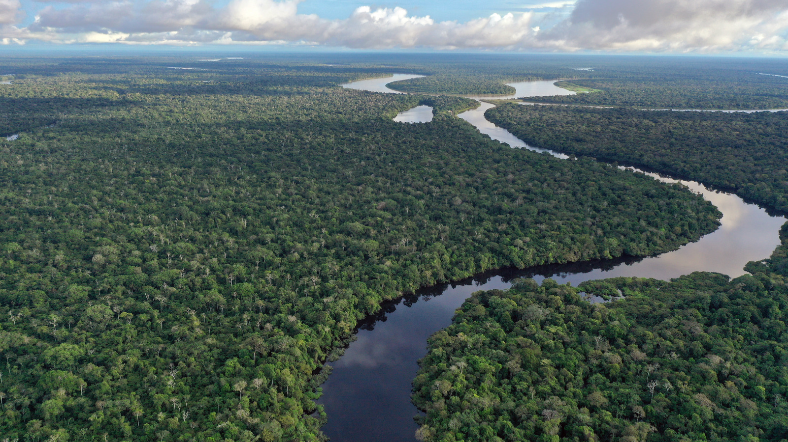
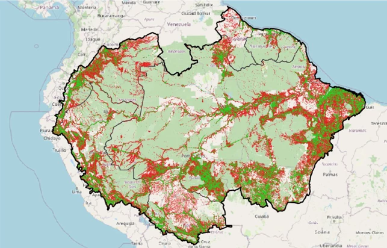

+++
title = "Closing the Digital Connectivity Gap in the Amazon"
authors = ["Niccolo Comini"]
categories = ["Case Study"]
partner = ["Ookla"]
dev_partner = ["World Bank"]
tags = ["Digital Development"]
links = ["https://blogs.worldbank.org/en/latinamerica/harnessing-digital-innovation-to-safeguard-the-amazon"]
date = 2026-11-02T00:00:00Z
+++

A new World Bank report, [Advancing Amazonian Conservation through Digital Technologies](https://openknowledge.worldbank.org/server/api/core/bitstreams/2a1bf22f-02eb-4454-9a8f-13b02acb18b3/content), examines how digital technologies can strengthen conservation monitoring across the Amazon biome. It offers guidance on adopting and using these tools effectively. As part of its analysis, the report used [Ookla®](https://www.ookla.com/ookla-for-good) data to estimate mobile and fixed broadband coverage across the region.

## Challenge

The Amazon rainforest is not only the world’s largest tropical forest but also a linchpin for global environmental stability and biodiversity. Its vast expanse regulates rainfall, stores immense amounts of carbon, supports biodiversity and serves as the ancestral homeland for more than 420 Indigenous Peoples and their communities. Yet, the Amazon faces mounting threats: environmental changes, rampant deforestation, and socio-economic pressures are pushing this vital ecosystem toward a tipping point.

Amid these challenges, digital technologies offer transformative potential for conservation and sustainable development. However, their promise can only be realized if foundational elements - technology, internet connectivity, and data governance are firmly in place.

<figure style="text-align: center;">
  
</figure>

## Solution

The report, [Advancing Amazonian Conservation through Digital Technologies](https://openknowledge.worldbank.org/server/api/core/bitstreams/2a1bf22f-02eb-4454-9a8f-13b02acb18b3/content), highlights how digital tools can strengthen conservation and sustainable development work on the Amazon. 

One key highlight of this analysis is closing the region’s connectivity gap. Digital conservation tools such as camera traps, drones, and Internet of Things sensors depend on reliable internet connectivity to deliver their full value.  Without robust connectivity, even the most advanced technologies cannot deliver timely data or support local action.

With the support of the Development Data Partnership, the report leveraged a unique dataset of Speedtest Intelligence® consumer-initiated results and signal scans provided by Ookla to estimate fixed and mobile broadband coverage in the Amazon biome. Combining mobile broadband signals (4G and 5G) and fixed broadband Speedtest measurements, it is estimated that only 3.5% of the biome has access to the internet. Coverage concentrates along main river corridors, transport axes, and urban areas. 

The disparity is greater in Indigenous territories. Internet coverage extends across only 0.93% of these territories and reaches just 63% of the population. These results indicate that the broadband population coverage gap in Indigenous areas is nearly three times the level observed in non-Indigenous areas.

<figure style="text-align: center;">
  
  <figcaption style="text-align: center; font-size: 0.9em; color: #555;">Source: Authors’ analysis. Map adapted by the team from Data Basin (Riveros, 2012). It does not include Venezuela.
Note: Red and dark green dots are populated areas. Red areas are unserved by internet while dark green have access to internet.
</figcaption>
</figure>

## Impact

The [report](https://openknowledge.worldbank.org/server/api/core/bitstreams/2a1bf22f-02eb-4454-9a8f-13b02acb18b3/content) provides recommendations to bridge the connectivity gap in the Amazon. For instance, national governments should dedicate budget resources to connectivity projects, seek co-financing through regional partnerships, use universal service funds for targeted investment, and work with thousands of small and medium-sized Internet Service Providers (ISPs) to deliver last-mile connections. Development organizations such as the World Bank Group and the Inter-American Development Bank could support large-scale infrastructure through concessional loans and guarantees. 

The report also recommends better integrating telecommunications infrastructure across the Amazon to build a more robust and resilient regional network.

Measuring outcomes over time will also be essential to assess whether investments in fiber, mobile and satellite infrastructure are improving connectivity, particularly for communities with the greatest need.

Strong connectivity would allow digital technologies to contribute effectively to conservation and sustainable development in the Amazon. Expanding coverage will require governments, the private sector, multilateral development organizations, and communities to develop solutions that are inclusive, suited to local conditions, and sustainable over time.

