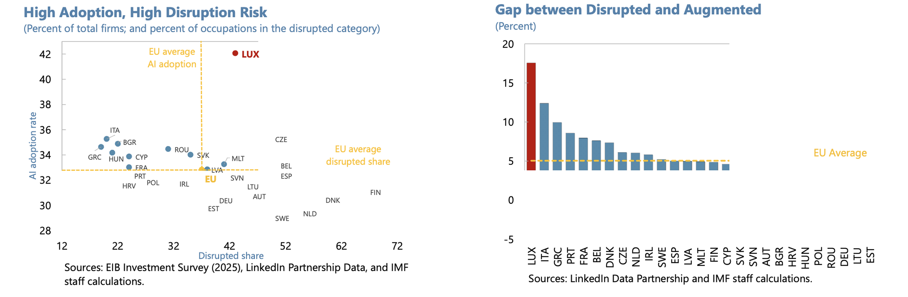

+++
title = "Using LinkedIn Data to Understand AI Exposure and Skills Gaps in Luxembourg"
authors = ["Xinjue “Cheryl” Li"]
categories = ["Case Study"]
partner = ["LinkedIn"]
dev_partner = ["International Monetary Fund"]
tags = ["Jobs and Development", "Ai"]
date = 2026-11-23T00:00:00Z
+++

Artificial intelligence (AI) offers significant productivity opportunities for Luxembourg, particularly given its high-wage, services-oriented economy and strong financial sector. However, realizing these gains will depend on whether the workforce has the skills needed to adapt. Using [LinkedIn Pulse](https://pulse.linkedin.com) (formerly LinkedIn Economic Graph) data through the Development Data Partnership, together with evidence on AI adoption, an International Monetary Fund (IMF) project identifies a substantial gap between occupations likely to be disrupted by AI and those likely to benefit from it. Luxembourg has the largest such gap in the European Union (EU), highlighting the importance of skills development and cross-border labor mobility in supporting the AI transition.

## Challenge

Luxembourg is particularly exposed to the opportunities and challenges presented by AI. Its concentration in finance and professional services, combined with relatively high labor costs, creates strong incentives for firms to adopt AI. At the same time, a significant share of employment is concentrated in occupations where AI may substitute for existing tasks rather than complement workers.

A key challenge is understanding whether the workforce has the skills needed to translate high AI exposure into productivity gains. Traditional labor market statistics provide valuable information on employment and occupations, but often lack the timeliness and granularity needed to capture rapidly changing skills requirements. This challenge is particularly relevant for Luxembourg, where a substantial share of the workforce consists of foreign residents and cross-border commuters, making labor market adjustments a regional rather than purely domestic issue.

<figure style="text-align: center;">
  
</figure>

## Solution

To better understand these challenges, an IMF project draws on LinkedIn data made available through the Development Data Partnership, alongside the EIB Investment Survey and IMF staff calculations.

The analysis distinguishes between two categories of AI-exposed occupations: _augmented occupations_, where AI is more likely to complement workers' existing skills and enhance productivity; and _disrupted occupations_, where AI is more likely to substitute for tasks currently performed by workers.

The findings highlight three important patterns:

First, Luxembourg combines one of the highest AI adoption rates in Europe with a particularly high share of employment in disrupted occupations. This suggests substantial opportunities for productivity improvements, alongside significant potential labor market adjustment.
 
Second, Luxembourg has the largest gap between disrupted and augmented occupations in the EU, at approximately 17 percentage points, compared with an EU average of around 5 percentage points. Strong demand for AI-related and emerging skills, combined with limited domestic supply, may constrain the realization of productivity gains. Luxembourg's reliance on foreign and cross-border workers further underscores the importance of regional skills availability.

Third, the financial sector illustrates how AI exposure can differ within an industry. LinkedIn data show that Luxembourg has a relatively high share of financial-services employment in disrupted occupations and a comparatively low share in augmented occupations. This may reflect the concentration of back-office, administrative, and support roles, where AI could replace certain tasks rather than primarily complement existing work.

<figure style="text-align: center;">
  
</figure>

## Impact

LinkedIn data provide a valuable complement to traditional labor market statistics by offering more timely and granular insights into occupational exposure and the supply of and demand for skills. For Luxembourg, these insights help identify where AI-related labor market adjustments may be most pronounced and where additional skills development could support productivity growth.

The findings suggest that policy priorities should extend beyond encouraging AI adoption. Strengthening reskilling and lifelong learning, supporting workers in routine-intensive occupations, and facilitating the development of AI-complementary skills will be important for managing the transition. Given Luxembourg's reliance on cross-border employment, cooperation with neighboring countries on skills development and training is also particularly relevant.

An important remaining question is how workers move between occupations as AI adoption progresses. While current data help identify exposure and skills imbalances, understanding individual career transitions would provide further insights into whether workers can successfully move toward AI-complementary roles.

**For Luxembourg, realizing AI's productivity potential will require not only greater technology adoption, but also proactive policies to help workers adjust and to ensure that the benefits of technological progress are broadly shared.** 

