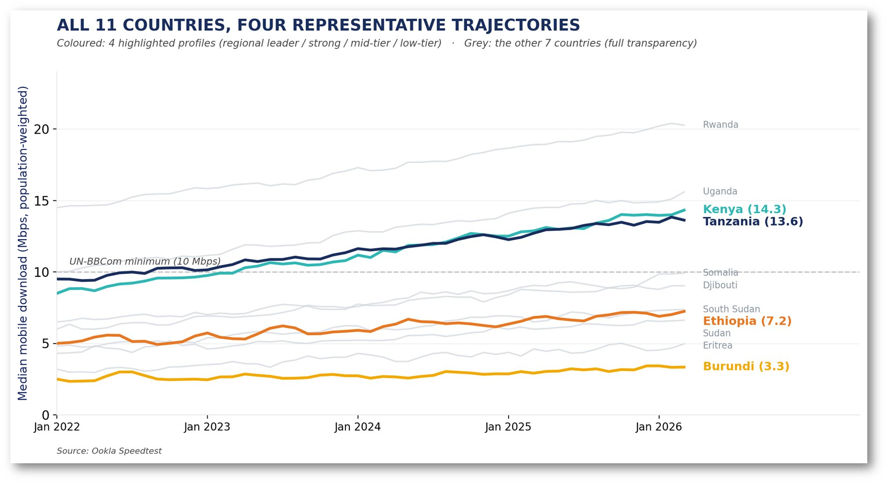

+++
title = "Mapping Digital Connectivity Gaps to Guide Infrastructure Investment in East Africa"
authors = ["Momar Kouta", "Mohamed Ali Hadj Taieb"]
categories = ["Case Study"]
partner = ["Ookla"]
dev_partner = ["African Development Bank"]
tags = ["Digital Development"]
date = 2026-10-19T00:00:00Z
+++

Where should digital infrastructure investment go first? The African Development Bank (AfDB) is combining [Ookla®](https://www.ookla.com/ookla-for-good) connectivity data with population and social infrastructure data to identify digital connectivity gaps and support investment prioritization across 11 East African countries — Burundi, Djibouti, Eritrea, Ethiopia, Kenya, Rwanda, Somalia, South Sudan, Sudan, Tanzania and Uganda.

## Challenge

Digital connectivity varies widely across East Africa, not only between countries, but also between communities within the same country. Yet the data traditionally used to guide infrastructure decisions do not always provide the level of detail needed to understand these differences.

National averages can hide significant gaps between capital cities and rural districts. Traditional household surveys often operate on multi-year cycles, and the time required to collect and process the data can make it difficult to capture recent infrastructure developments. At the same time, countries may use different definitions, methodologies, and reference years, making it difficult to compare connectivity needs consistently across borders.

For the AfDB, which has invested more than $2 billion in digital and data infrastructure over the past decade, this raised a fundamental question: which regions — down to the district level — should come first in investment decisions?

## Solution

Through the Development Data Partnership, AfDB developed a digital intelligence platform using Ookla Speedtest and network coverage data to provide a more granular and comparable picture of digital connectivity across 11 East African countries.

At the heart of the analysis are millions of user-initiated Ookla Speedtests collected over 51 months, from January 2022 to March 2026, spanning both mobile and fixed networks. The analysis combines these measurements with data on mobile cellular network coverage (2G, 3G, 4G and 5G), fine-grained population distribution from Meta’s High Resolution Settlement Layer (HRSL) and WorldPop, administrative boundaries, and 93,125 health and education facilities drawn from OpenStreetMap. Together, the datasets allow the team to examine conditions across 8,925 administrative areas.

A key part of the methodology is accounting for where people actually live. A simple analysis in which every Speedtest receives equal weight can be influenced by locations and users generating more tests. The platform therefore also allows each connectivity measurement to be weighted according to the population at its location, providing a different perspective on the experience of the wider population.

<figure style="text-align: center;">
  
  <figcaption style="text-align: center; font-size: 0.9em; color: #555;">Figure 1: Population-weighted connectivity across the 11 countries, 2022–2026

Note: When Speedtests are weighted by where people actually live, they show which areas are ahead, which are behind, and which aren’t improving. A simple count of tests can hide these patterns.
</figcaption>
</figure>

The platform combines connectivity and network coverage into a Digital Inclusion Score. This is then combined with population density and a “social amplifier” based on the distribution of health and education facilities to calculate an Investment Priority Score. The resulting score helps classify areas by investment priority and identify critical regions that may require intervention. Users can compare countries, drill down across different administrative levels, adjust priority thresholds, and switch between test-weighted and population-weighted approaches to analyzing connectivity data.

## Impact

The platform provides a common analytical framework for examining digital infrastructure gaps across 11 countries while moving beyond national averages to a much more granular subnational picture. It can identify critical regions and compare needs across countries using a harmonized methodology. By bringing together connectivity gaps, information on population, and the distribution of health and education facilities, the platform provides a more targeted evidence base for understanding where digital infrastructure needs may be greatest.

The platform is also designed to be reproducible, allowing the methodology to be extended to other regions using new input data. AfDB intends to work with Ookla to extend this approach to other regions of Africa, while also automating and scaling up its data pipelines. By turning millions of connectivity measurements into granular comparable insights, the project shows how private sector data can help development institutions better understand digital infrastructure gaps and support more informed decisions about where investment may be needed most.

